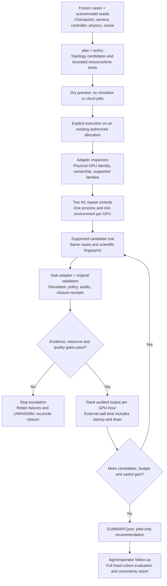
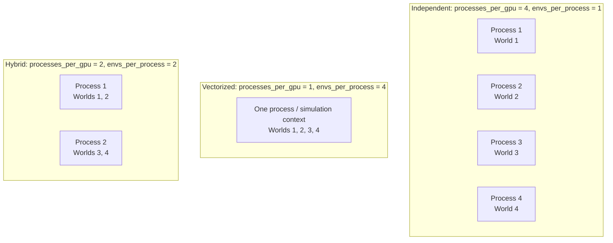
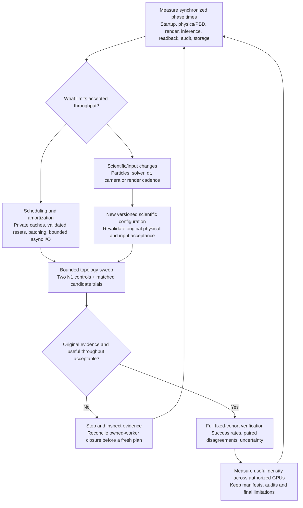

# Sim Eval Scale

[](https://github.com/asimfish/sim-eval-scale/actions/workflows/tests.yml)
[](pyproject.toml)
[](LICENSE)

Evidence-gated throughput experiments for simulator evaluation and data collection.

**Four independent worlds per GPU is a tested fallback, not a scaling ceiling.** This project separates GPU count, simulator process count and vectorized environments per process. It helps agents explore independent, vectorized and hybrid execution while retaining original workload acceptance checks.

[中文说明](README.zh-CN.md) · [Agent workflow](docs/agent-playbook.md) · [Liquid/vision tuning](docs/liquid-and-vision.md) · [Adapter protocol](docs/adapter-protocol.md)

## What works today

- A standard-library Python core with bounded trial/time/GPU/world limits.
- Topology planning for rigid-state, rigid-vision and PBD-liquid/vision workloads, including 1024+ environment candidates.
- Two N1 repeat controls, fixed scenes/model seeds, same-allocation binding, original audit hashes and independent lane-state checks.
- Useful-throughput ranking, resource/quality rejection, plateau stopping and explicit unknown/infrastructure outcomes.
- Atomic publication of large hot JSON snapshots; private subprocess working directories and opt-in credential forwarding.
- CPU tests, a synthetic runnable example, and an experimental installed-Isaac-Lab state capacity probe.

**Not bundled:** a universal Isaac task/policy adapter, simulator assets, model weights or cloud credentials. Actual evaluation/collection needs your task adapter and original acceptance oracle. The capacity probe is not a policy success test. There is no claim that1024 fluid/RGB environments have been measured.

## How it works

### 1. From a frozen workload to an evidence-gated recommendation



The adapter runs your real task and validators; the core checks report bindings and evidence integrity. Unsupported or undersized candidates are skipped. A rejection stops the current sweep. The full-cohort follow-up is an agent/operator responsibility, not an automatically executed CLI phase.

### 2. Three different ways to use one GPU



Each box group is an alternative layout on **one GPU**, not three simultaneous allocations. All have four worlds/GPU, but different startup, memory and isolation costs. Total worlds = GPUs × processes/GPU × worlds/process. Independent-process validation does not establish shared-scene vectorized correctness; each adapter must validate its supported families.

### 3. The agent optimization loop



This loop is guidance for agents, not an autonomous cloud scheduler. Optimize accepted output per GPU-hour; high utilization or lower fidelity alone is not a speedup. See the [agent playbook](docs/agent-playbook.md) for the executable handoff and the [liquid/vision matrix](docs/liquid-and-vision.md) for individual tuning variables.

## Quick start: no GPU required

Requirements: Git and Python 3.10+ with `venv`/pip. Linux is required for workload subprocess lifecycle control. Install from source; this project has not been released on PyPI.

```bash
git clone https://github.com/asimfish/sim-eval-scale.git
cd sim-eval-scale
python3 -m venv .venv
source .venv/bin/activate
python -m pip install .

# Every output path must be new. mktemp makes the example safe to repeat.
RUN_DIR=$(mktemp -d /tmp/sim-eval-scale.XXXXXX)
python examples/synthetic_demo.py --output "$RUN_DIR/demo"
sim-eval-scale plan --profile rigid-state --gpus 1 \
  --max-envs-per-gpu 1024 --output "$RUN_DIR/state-plan.json"
sim-eval-scale plan --profile liquid-vision --gpus 4 \
  --max-envs-per-gpu 64 --max-processes-per-gpu 4 \
  --output "$RUN_DIR/liquid-plan.json"
sim-eval-scale sensor-budget --envs 1024 --width 640 --height 480 --hz 15
sim-eval-scale diagnose examples/profile.json
```

The demo writes `demo/EXAMPLE.json`; plans list candidate topologies. These commands create no simulator or cloud jobs. Synthetic results are explicitly labelled and cannot qualify as actual workload evidence. The source checkout is needed for `examples/` and `docs/`; installing a wheel alone installs the CLI/library.

## Choose your starting point

| Goal | Entry point | Evidence produced |
| --- | --- | --- |
| Understand scheduling without hardware | Quick start above | Synthetic example and candidate plans |
| Integrate an existing task or policy | [Adapter protocol](docs/adapter-protocol.md) | Real task evidence supplied by your adapter |
| Find a useful concurrency level | Real workload sweeps below | Bounded pilot recommendation, including rejected candidates |
| Diagnose liquid or RGB bottlenecks | [Tuning matrix](docs/liquid-and-vision.md) | Workload-specific synchronized measurements |
| Explore camera-free state capacity | Experimental probe below | Capacity diagnostic, not learned-policy success |
| Hand work to an agent | [Agent playbook](docs/agent-playbook.md), [AGENTS.md](AGENTS.md) | Reproducible manifests, measurements and handoff |

## For coding agents

Give your agent this instruction from the repository checkout:

> Read AGENTS.md, README.md, docs/agent-playbook.md, docs/adapter-protocol.md and SECURITY.md. Run the CPU quick start first. Inspect the existing authorized GPU allocation and task adapter. Freeze the original workload and acceptance criteria; propose a bounded dry plan, then measure accepted output per GPU-hour while retaining all failures and unknown outcomes. Report evidence and limitations. Do not create extra cloud resources without authorization.

No internal workflow service, private host or credentials are needed for the CPU example. A real integration needs your installed simulator, task assets/model, reviewed adapter and existing allocation. Follow host repository rules when embedding this toolkit elsewhere.

## Real workload sweeps

Implement the [adapter protocol](docs/adapter-protocol.md), freeze a full scene/model-seed manifest and a scientific runtime manifest, then run the commands below. Paths marked `/absolute/` are placeholders for your own files, not bundled examples.

Before execution:

1. Bind the allocation to actual physical GPU UUIDs and verify ownership/foreign processes.
2. Freeze cases, scene/model seeds, checkpoint, input processing, controller, physics and original acceptance oracle. Include adapter source/version in the runtime manifest.
3. Implement inspection and trial reports, original audit wrappers, hashed correctness evidence and positive worker-closure receipts. Declare only supported topology families.
4. Include enough cases for at least two full waves at each candidate concurrency. For four GPUs × 16 environments/GPU, that means at least 128 cases; a 100-case roster cannot qualify that candidate under the default wave requirement.
5. Run two N1 controls and validate input/state/trajectory contracts before selecting a pilot winner. The toolkit checks report integrity; your validators establish scientific correctness.


```bash
sim-eval-scale policy --plan /absolute/topology-plan.json \
  --cases /absolute/pilot-cases.json --runtime-manifest /absolute/runtime-manifest.json \
  --adapter-json '["python3","/absolute/task_adapter.py"]' \
  --mode evaluation --authorized-allocation --output /absolute/policy.json

# Preview. Output directories are exclusive; use a fresh path for each run.
sim-eval-scale sweep --policy /absolute/policy.json --output /absolute/preview
# Execute only inside the already authorized, inspected GPU allocation.
sim-eval-scale sweep --policy /absolute/policy.json --output /absolute/sweep --execute
```

Use `--mode collection` for Data-Gate-passed training trajectories. Do not replace original success criteria, silently resample failures or drop audit data to raise throughput. Default CLI headroom is2GiB; set an appropriate per-GPU bound before trials (for example8GiB on a large-memory workload). Pilot tolerances are configuration defaults, not proven universal equivalence margins.

The selected score is independently audited episodes/GPU-hour for evaluation, or original-Data-Gate-accepted unique trajectories/GPU-hour for collection. It includes adapter startup and audit drain. GPU utilization and allocated VRAM are supporting measurements, not the optimization objective.

## High-density state capacity probe

Inside a compatible, user-installed Isaac Lab2.x environment and an exclusive owned allocation:

```bash
# GPU UUID/allocation ID must come from your real allocation inventory.
python examples/isaaclab_state_benchmark.py \
  --expected-gpu-uuid YOUR_ACTUAL_GPU_UUID --owned-allocation-id YOUR_JOB_ID \
  --num-envs 1024 --device cuda:0 --steps 256 --output /absolute/new-capacity-run
```

This is an experimental camera-free, zero-action state task probe. Only CLI/source checks run in CPU CI; run it on your installed SDK before relying on its output. It does not validate liquid, vision, learned policies or task success. More environments require explicit bounds and measured capacity, not an extrapolation from this example.

## Why liquid/RGB needs a separate protocol

At 1024 environments, one 640×480 RGB camera at15Hz produces about14.16GB/s of raw RGB payload before accounting for renderer history, conversion, inference, extra cameras and recordings. That is not measured bus traffic or total VRAM. PBD neighbor solving, particle readback and liquid surface meshing add distinct costs. Benchmark these phases instead of attributing all GPU busy time to liquid physics.

See [the parameter matrix and diagnostic protocol](docs/liquid-and-vision.md). Changes to particle spacing/neighborhood/solver settings are fidelity changes and require separate acceptance. Camera resolution, render cadence and liquid appearance can change policy inputs even when physics stays identical.

## Evidence and limitations

A prior task-specific implementation completed independent-worker learned-policy evaluations with4×96GB GPUs and4 worlds/GPU. Sampled GPU utilization was93–98%, with one completion window around45 cases/hour. This is workload-specific evidence, not a reproducible benchmark package or a universal speedup claim. Aggregate single/multi success rates were close, but strict predeclared statistical equivalence and per-trajectory identity were not established. Private inputs/logs are not distributed.

## Read the results

A sweep creates `PLAN.json`, per-trial requests/logs/reports and `SUMMARY.json`. Inspect the summary's recommendation and stop reason, then retain the full original audits. `pilot_only=true` means the winner still needs a full fixed-cohort evaluation. A larger environment count is useful only when accepted end-to-end throughput improves within correctness and resource limits.

Evaluation throughput counts independently audited completed episodes, including genuine model failures; success rate is reported separately. Collection throughput counts only unique trajectories accepted by the original Data Gate. Infrastructure errors and unknown outcomes must remain visible and cannot be relabelled as model failures or dropped from reporting.

## Troubleshooting

| Symptom | Action |
| --- | --- |
| Output already exists | Use a fresh output path; exclusive creation protects earlier evidence. |
| Candidate skipped for insufficient cases | Increase the predeclared roster or lower concurrency; keep the same roster across compared candidates. |
| Unsupported topology | Implement and validate that adapter family, or restrict the plan to supported families. |
| OOM or poor accepted throughput | Reduce density and profile physics, rendering, inference, readback and audit separately. |
| UNKNOWN or timeout | Reconcile descendant ownership/closure before another execution; do not automatically retry. |
| Different single/multi observations | Verify camera/light isolation, renderer GPU identity, reset state, RNG and full trajectories using the playbook. |
| Isaac Lab probe fails on your version | Record SDK versions and a minimal reproduction; the probe is experimental and CPU CI does not validate simulator compatibility. |

## Development

```bash
python -m pip install ".[dev]"
ruff check src tests examples
ruff format --check src tests examples
python -m unittest discover -s tests -v
python examples/synthetic_demo.py --output "$(mktemp -d)/demo"
```


Python3.10+, Linux for process-group lifecycle control. The core has no runtime third-party dependencies. Optional Isaac Lab/PyTorch/Gymnasium come from the user's licensed/version-pinned environment. See [CONTRIBUTING.md](CONTRIBUTING.md), [SECURITY.md](SECURITY.md) and [design decision](docs/adr-001-topologies.md).

MIT licensed. No NVIDIA SDK source or assets are redistributed.

## Support and contributions

Use [Issues](https://github.com/asimfish/sim-eval-scale/issues) for reproducible bugs and scoped feature requests. Include the commit, Python/simulator versions, redacted configuration, expected/actual behavior and relevant logs. For performance reports also include topology, hardware, timing method, full denominator and original acceptance evidence. Follow [CONTRIBUTING.md](CONTRIBUTING.md); never publish credentials or private datasets. See [SECURITY.md](SECURITY.md) for sensitive reports and [CHANGELOG.md](CHANGELOG.md) for releases.

The next integration work is task-specific real adapters and reproducible GPU benchmarks for vectorized vision/liquid workloads. These are contributions to validate, not capabilities established by CPU CI.
