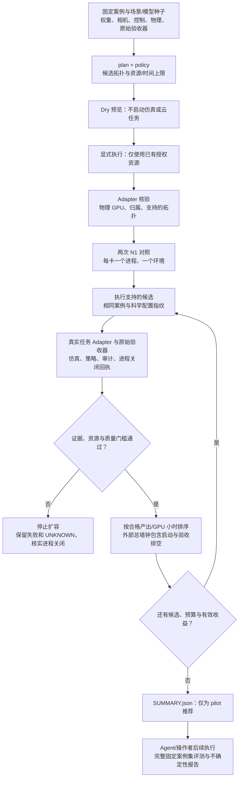
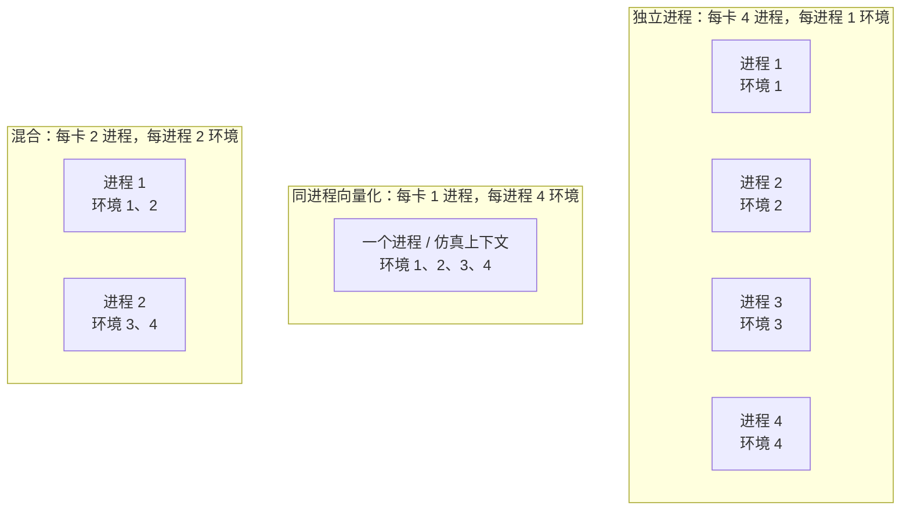
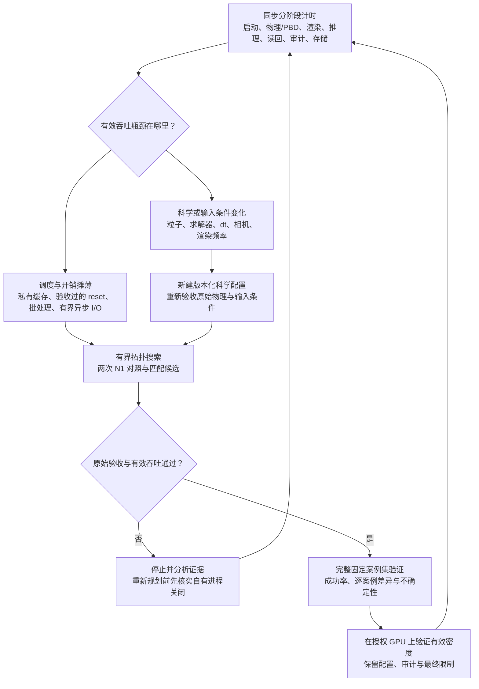

# Sim Eval Scale：多环境评测与采集调优

目标：在原始验收标准下，提高**合格回合/小时/GPU**，而不是单纯填满显存。

## 不把4环境/卡当成上限

- `GPU数`：资源数量。
- `processes_per_gpu`：每卡Kit/仿真进程数。
- `envs_per_process`：一个进程中的向量化环境数。
- 总环境数＝三者乘积。1024个环境不意味着1024个Kit进程。

支持三条候选路线：独立进程、同进程向量化、少量进程×多环境的混合方式。无液体状态任务优先尝试向量化到128/256/512/1024以上；视觉和PBD液体任务先验证输入/物理隔离，再分级增加密度。**这些是试探候选，不是实测容量承诺。**

## 机制图

### 1. 固定任务 → 并发搜索 → 证据验收



Adapter 负责真实任务及科学验收，核心负责证据完整性与绑定核查。不支持或预声明案例不足的候选跳过；验收拒绝会停止当前 sweep。完整案例集验证是 agent/操作者的后续工作，并非 CLI 自动完成。

### 2. 相同环境数，不同并行机制



三组分别表示**一张 GPU 的三种替代布局**，不是同时分配三组资源。每组都是四环境/卡，但启动、显存与隔离成本不同。总环境数 = GPU 数 × 每卡进程数 × 每进程环境数。独立进程测通不代表共享场景向量化已通过验收；每种拓扑都需 adapter 提供真实证据。

### 3. Agent 调优闭环



这是 agent 的执行方案，不是自动申请云资源的调度器。优化指标是原始验收下的产出/GPU 小时；高利用率或降低保真度本身不代表有效加速。具体步骤见 [agent playbook](docs/agent-playbook.md)，参数见[液体/视觉矩阵](docs/liquid-and-vision.md)。

## 已实现

- 可安装Python包和命令行；核心仅使用标准库。
- 依照资源上限生成多维拓扑，自动跑两次N1对照和后续候选。
- 固定场景/model seed、原始验收证据SHA、同物理GPU和运行指纹核验。
- 超时/未知退出/正确性失败停止扩容；按实际总墙钟有效吞吐选最佳配置，收益进入平台期就停。
- 采集模式额外检查原Data Gate的可训练标记。
- 大账本原子同步；默认不向任务子进程传API凭据。
- 合成CPU示例，以及需要自行安装Isaac Lab的实验性1024状态环境容量脚本。

实际模型/任务需接入[任务adapter](docs/adapter-protocol.md)。没有内置一个覆盖所有模型的Isaac启动器，也没有把1024液体/RGB环境标为已验证。

## 优化顺序

1. 同一GPU分配上两次N1，量出自身波动；再比较并发候选。
2. 分开测启动、刚体/PBD、渲染、推理、粒子读回、编码、审计和排队。
3. 优先复用可信缓存、减少Kit重复启动、批量推理与GPU内数据流、原标准下的异步验收与写盘。
4. 尝试TiledCamera与同进程向量化；检查跨环境灯光、碰撞、粒子、reset、相机/动作lane，不能只检查最终成功率。
5. 少录辅助视频和少拷贝粒子应区分“非必要输出”与“原验收必需证据”。不能删除后者。
6. 粒子间距/邻域、迭代数、dt、碰撞简化属于物理变化；相机分辨率/渲染频率/液体表面效果属于输入变化。需隔离新配置重新验收，不能混入原基线成绩。
7. 单卡有效吞吐与密度测清后，再增加GPU数量分片任务。卡多不自动让同一个物理世界更快。

[安装与命令](README.md) · [液体/视觉参数矩阵](docs/liquid-and-vision.md) · [交给其他agent的执行流程](docs/agent-playbook.md)

## 从零安装与重复运行

尚未发布到 PyPI；请从源码安装。需要 Git、Python 3.10+、venv/pip；执行真实负载的进程管理需要 Linux。

```bash
git clone https://github.com/asimfish/sim-eval-scale.git
cd sim-eval-scale
python3 -m venv .venv
source .venv/bin/activate
python -m pip install .
RUN_DIR=$(mktemp -d /tmp/sim-eval-scale.XXXXXX)
python examples/synthetic_demo.py --output "$RUN_DIR/demo"
sim-eval-scale plan --profile liquid-vision --gpus 4 \
  --max-envs-per-gpu 64 --output "$RUN_DIR/plan.json"
```

这些命令不申请云资源，不运行 GPU 仿真。示例输出是合成数据，不是性能或成功率证据。每次使用新输出路径，避免覆盖已有证据。

## 给其他 agent 的入口

把以下指令交给仓库内的 agent：

> 阅读 AGENTS.md、README.md、docs/agent-playbook.md、docs/adapter-protocol.md 和 SECURITY.md。先完成 CPU 快速开始，再核对现有授权 GPU、任务 adapter 和原始验收器。固定模型、场景、种子、输入处理、控制与物理条件，先生成有界 dry plan，再用原始验收通过的产出/GPU 小时选择并发度。保留失败、未知结果和完整证据；未经授权不创建额外云资源。

真实评测需要自己接入已安装的仿真器、模型、资产和 adapter；本项目没有通用 Isaac 任务 adapter。默认需要至少两轮填满并发槽位：四卡、每卡16环境至少需要128个预先固定案例，100条不足以验收该候选。详细安装、结果解释、故障处理与贡献入口见[英文主文档](README.md)。

`SUMMARY.json` 的 `pilot_only=true` 只表示试运行推荐，不代表正式统计等价。评测吞吐包含通过独立审计的真实成功和失败；采集吞吐仅包含原始 Data Gate 验收的唯一合格轨迹。UNKNOWN 必须核实进程关闭后再继续。

问题请提交到 [Issues](https://github.com/asimfish/sim-eval-scale/issues)，附版本、脱敏配置、复现和证据；不要上传凭据或私有数据。贡献规范见 [CONTRIBUTING.md](CONTRIBUTING.md)。
